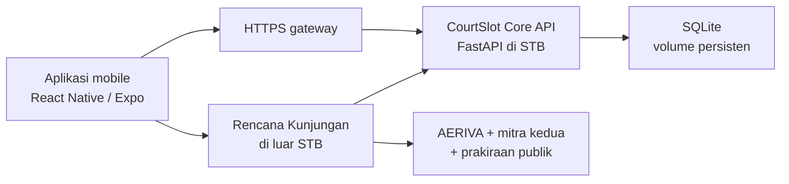

# CourtSlot

CourtSlot adalah rancangan platform reservasi fasilitas publik kota. Warga dapat melihat ketersediaan dan mengajukan reservasi; petugas mencatat pemesanan dari kanal lain dalam kalender yang sama; instansi mengatur fasilitas, kebijakan, dan penutupan resmi. Proyek ini dibuat untuk tugas besar II3160 Teknologi Sistem Terintegrasi dan II3140 Pengembangan Aplikasi Web & Mobile oleh Keisha Daffa Aryani dan Yumna Fathonah Kautsar.

> Status: baseline perencanaan. Repo ini belum berisi aplikasi atau konfigurasi deployment. Kerja sama pemerintah kota, fasilitas, dan data demo adalah skenario perancangan, bukan layanan pemerintah yang sudah berjalan.

## Tujuan dan batas produk

- **Pengguna:** warga, petugas fasilitas, admin dinas; peran operator mitra dan analis kota disiapkan dalam model, tetapi tidak harus memiliki seluruh tampilan pada demo awal.
- **Nilai inti:** satu sumber ketersediaan fasilitas, tanpa pemesanan ganda atau kapasitas berlebih, dengan kebijakan akses warga yang dapat ditelusuri.
- **Unit pesan:** bagian fasilitas yang dapat dipesan, misalnya satu lapangan atau area kursi baca. Satu fasilitas dapat memiliki beberapa unit.
- **Dua model pemesanan:** `EXCLUSIVE_SLOT` untuk satu pemesan per slot dan `CAPACITY_BASED` untuk beberapa pemesan sampai kapasitas terpenuhi.
- **Batas pilot:** satu kota dengan data uji untuk lapangan, perpustakaan, dan taman. Implementasi penuh dimulai dari slot eksklusif, lalu satu unit berbasis kapasitas (kursi baca).
- **Di luar MVP:** pembayaran/retribusi, persetujuan acara besar, seluruh fasilitas dalam kota, dan integrasi resmi pemerintah.

Dalam skenario bisnis, pemerintah kota adalah pembayar layanan platform dan warga tidak dikenai biaya aplikasi. Tarif fasilitas hanya ditampilkan sesuai kebijakan instansi; pembayaran dilakukan di kanal resmi di luar CourtSlot. Angka biaya dan margin dalam dokumen tugas adalah hipotesis untuk analisis, bukan harga produk yang sudah divalidasi.

## Model domain (DDD)

| Kategori | Subdomain / bounded context | Tanggung jawab |
| --- | --- | --- |
| Core | Reservasi dan Akses | Menghitung ketersediaan, menegakkan kapasitas dan kuota, serta mengubah status reservasi secara atomik. |
| Supporting | Katalog Fasilitas | Memiliki data instansi, fasilitas, unit pesan, jam operasional, kebijakan, dan tarif. |
| Supporting | Pemeliharaan dan Penutupan | Menerbitkan penutupan resmi yang memblokir slot dan memengaruhi reservasi terkait. |
| Supporting | Rencana Kunjungan | Menggabungkan informasi slot, prakiraan cuaca, dan kondisi akses dari mitra untuk membantu keputusan warga; ditempatkan di luar STB. |
| Supporting | Pelaporan | Mengolah riwayat pemanfaatan tanpa mengambil alih keputusan reservasi. |
| Generic | Identitas, notifikasi, audit | Mengelola peran, menyampaikan perubahan status, dan menyimpan jejak perubahan. |

**Batas kewenangan:** hanya konteks Reservasi dan Akses yang boleh memutuskan apakah pemesanan sah. Katalog memiliki definisi unit dan kebijakan; Penutupan mengumumkan keputusan instansi; Rencana Kunjungan hanya membaca dan memberi peringatan. Prakiraan cuaca atau laporan akses tidak membatalkan reservasi otomatis. Bounded context adalah batas model, bukan keharusan membuat satu microservice per konteks: modul-modul internal dapat berada dalam satu Core API di STB.

Istilah utama: `Facility` (lokasi publik), `BookableUnit` (bagian yang dipesan), `TimeSlot` (rentang waktu pada unit), `Reservation` (hak pakai pemesan), `FacilityClosure` (penutupan resmi), dan `BookerStanding` (kuota serta catatan ketidakhadiran).

### Aturan yang harus dijaga

1. Satu slot `EXCLUSIVE_SLOT` tidak boleh mempunyai lebih dari satu reservasi aktif; jumlah peserta aktif pada sesi `CAPACITY_BASED` tidak boleh melampaui kapasitas.
2. Reservasi hanya dibuat dalam jam operasional, jendela pemesanan, dan kuota pengguna yang ditetapkan kebijakan unit. Pesanan yang dicatat petugas tetap memakai pemeriksaan yang sama.
3. Pemindahan jadwal memeriksa slot tujuan dalam transaksi yang sama; jika gagal, reservasi lama tetap berlaku.
4. Penutupan resmi memblokir slot dan membatalkan reservasi terdampak dengan alasan yang tercatat. Peringatan cuaca dan kondisi akses tidak mengubah status reservasi.
5. Perubahan status dan koreksi kehadiran dicatat bersama aktor, waktu, dan alasan. API baca untuk kelompok lain tidak membocorkan identitas pemesan.

Parameter awal rancangan, seperti jendela H-14, kuota dua reservasi per kategori per pekan, dan tenggang check-in 15 menit, adalah *default* yang dapat dikonfigurasi per unit. Jangan mengunci angka tersebut dalam logika aplikasi.

## Arsitektur yang direncanakan

- **Core API:** satu service FastAPI dalam Docker di STB. Modul internal mengikuti bounded context; transaksi database menjaga konflik slot dan kapasitas saat ada permintaan bersamaan.
- **Data:** SQLite dengan volume persisten untuk pilot. Kelayakan image Docker, memori STB, dan ketahanan data setelah kontainer dibuat ulang perlu diuji sebelum memilih konfigurasi final. Jika skala atau pola tulis meningkat, evaluasi PostgreSQL.
- **Akses:** gateway Nginx dan Cloudflare Tunnel adalah usulan untuk HTTPS publik; konfigurasi, domain, dan kontrol akses belum ditetapkan di baseline ini. Jangan menaruh kredensial, token tunnel, atau data warga asli di repo.
- **Mobile:** React Native dan Expo dengan tampilan berdasarkan peran. Aplikasi memanggil Core API untuk katalog dan reservasi.
- **Integrasi:** Rencana Kunjungan berada di luar STB; memakai API baca CourtSlot, kontrak AERIVA, kandidat mitra kedua dari API Registry, dan prakiraan publik. Adapter menerjemahkan data mitra; kegagalan salah satu sumber menampilkan status tidak tersedia dan tidak menghalangi pemesanan.

Kontrak API awal yang perlu disepakati: daftar fasilitas/unit, slot tersedia, buat/pindah/batalkan reservasi, check-in, penutupan resmi, dan endpoint baca ketersediaan agregat untuk mitra. Path dan skema respons baru ditentukan saat implementasi, lalu dipublikasikan lewat OpenAPI. Pemilik data reservasi tetap CourtSlot.

## Urutan kerja

1. Sepakati skenario demo, data uji, peran yang benar-benar diimplementasikan, serta prioritas aturan domain dari rancangan tugas.
2. Tetapkan kontrak API dan model data untuk fasilitas, unit, slot, reservasi, dan penutupan. Putuskan perilaku ketika dua permintaan masuk bersamaan.
3. Bangun Core API dan uji aturan konflik slot, kapasitas, kuota, pemindahan, serta penutupan. Pastikan data tetap ada sesudah kontainer dibuat ulang.
4. Bangun alur mobile warga dan tampilan petugas/admin yang diperlukan untuk demo.
5. Integrasikan Rencana Kunjungan setelah kontrak AERIVA dan kelompok kedua tersedia; tampilkan kegagalan sumber secara eksplisit.
6. Uji end-to-end melalui HTTPS di STB: warga memesan, permintaan bentrok ditolak, petugas check-in, admin menutup unit, dan reservasi terdampak berubah sesuai aturan.

Desain: [Figma Y2K](https://www.figma.com/design/0BHK9h77LUCvGAzNkvDngJ/Y2K?node-id=0-1). Acuan domain dan model bisnis: *Perancangan Layanan Inti CourtSlot untuk Reservasi Fasilitas Publik Kota Berbasis Domain-Driven Design* (dokumen tugas kelompok). Detail visual Figma perlu dicocokkan kembali sebelum implementasi layar.
